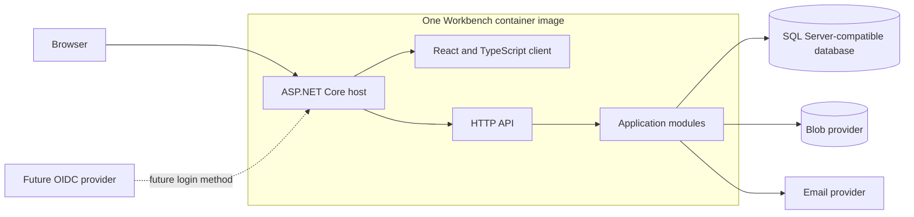

# Workbench architecture

## Shared gem reference foundation

[Read this section](architecture-gem-reference.md#shared-gem-reference-foundation).

## Scope and implementation status

Workbench is a portable, containerized modular monolith. A React and TypeScript client
and an ASP.NET Core API are published together as one container image. SQL Server is the only
initial structured-data engine, and a provider-neutral blob contract isolates binary storage.

The application-foundation and data-and-identity phases are implemented. The React client, typed
ASP.NET Core API, SQL persistence, tenant isolation, built-in identity, durable sessions, health
contracts, same-origin publish path, explicit database operations, and hardened container topology
are present and covered by source, integration, browser, migration, permission, restore, publish,
and container checks. Portable filesystem/Azure blob storage, immutable SQL revisions, encrypted SMTP
outbox delivery, and an explicit SQL-leased worker now provide the operational service foundation.
The Azure deployment phase supplies Bicep, scoped workload identities, explicit migration and worker
jobs, and a production Compose topology. Its recorded hosted acceptance and remaining limits are owned by the
[current acceptance matrix](operations/production-readiness.md); see the
[Azure deployment runbook](operations/azure-deployment.md) and
[self-hosting runbook](operations/self-hosted-deployment.md). See the [provider runbook](operations/blob-and-service-providers.md)
for configuration, paired recovery, and migration procedures.

Current user workflows are owned by the [collection guide](collection.md). The following collection
sections describe technical contracts and link their historical design rationale.

Collection search applies a tenant-scoped literal phrase predicate to names, notes and locations
before chronological pagination. Matching is case-insensitive and accent-sensitive with an explicit
SQL collation; queries are trimmed and limited to 200 UTF-16 code units. The tenant/chronology index
is retained; arbitrary substring queries can scan the tenant's candidates. Navigation state stays in
authenticated application memory and resets on reload or authentication loss.

Descriptive edits use a required version token and a restricted SQL command. Text, photograph,
archive and restore transitions share the item rowversion; stale commands cannot overwrite a later
change. An immutable snapshot captured by the first edit preserves creation replay identity.
Successful edits invalidate collection pages while retaining query and view; failed saves keep
private in-memory drafts for explicit reconciliation.

Archive state is a separate timestamp. Active browsing/search excludes archived records; SQL rejects
descriptive and photo mutations until a checked restore clears only archive state. Identity,
creation/photo replay evidence and the current photograph are retained. Active and archive searches
have independent authenticated traversal state. Existing authorized links remain readable.
See [collection design records](collection.md#design-records) for the individual decisions and limits.

### Accounting configuration

[Read this section](architecture-accounting.md#accounting-configuration).

### Atomic journal foundation

[Read this section](architecture-accounting.md#atomic-journal-foundation).

### Classified purchase recognition

[Read this section](architecture-accounting.md#classified-purchase-recognition).

### Structured supplier bills

[Read this section](architecture-accounting.md#structured-supplier-bills).

### Supplier open items and allocations

[Read this section](architecture-accounting.md#supplier-open-items-and-allocations).

### Durable financial evidence

[Read this section](architecture-accounting.md#durable-financial-evidence).

### Supplier credit and cash sources

[Read this section](architecture-accounting.md#supplier-credit-and-cash-sources).

### Collection records export

[Read this section](architecture-collection-purchasing.md#collection-records-export).

### Collection identity

[Read this section](architecture-collection-purchasing.md#collection-identity).

### Item photographs

[Read this section](architecture-collection-purchasing.md#item-photographs).

### Purchase orders

[Read this section](architecture-collection-purchasing.md#purchase-orders).

## Architectural invariants

1. Hosted and self-hosted installations use the same application source, feature set, data model,
   migrations, and container image.
2. The server is authoritative for authentication, authorization, tenant identity, and all durable
   state changes.
3. The server derives `TenantId` from durable authenticated user state. An ordinary client cannot
   select or override its tenant.
4. Every tenant-owned structured record has a non-null `TenantId`, and tenant-local uniqueness
   includes it.
5. A user belongs to exactly one tenant; a tenant may have multiple users.
6. SQL Server is the only initial structured-data engine. Documents that do not justify a separate
   database are stored as versioned JSON in SQL.
7. Binary content is stored behind a provider-neutral blob contract; metadata and tenant ownership
   remain in SQL.
8. The web tier is stateless across replicas. Durable sessions, jobs, and coordination live outside
   process memory.
9. Built-in ASP.NET Core Identity is the initial authentication system. External OIDC is an
   additive login method, not a replacement for Workbench tenant and authorization state.
10. Database migrations are an explicit deployment operation and do not run automatically when a
    web replica starts.
11. Secrets and provider credentials enter through deployment configuration and are never stored in
    source control, logs, the container image, or the browser.
12. New infrastructure is introduced only when measured requirements justify its operational cost.
13. Ordinary dual writes across independent stores are prohibited. Cross-store synchronization has
    one explicit source of truth, durable delivery, idempotency, observable retries, and reconciliation.
14. Public API contracts do not expose database entities, ORM types, provider object identifiers,
    storage keys, or cloud-provider types.

## Application structure

The browser uses one public origin. In production, ASP.NET Core serves the compiled client and the
API. During development, the client development server may proxy API requests, but that convenience
must not create a second production architecture.

Development projects remain independently runnable: starting the server does not implicitly own
the client development lifecycle. Production combines client and API behind one origin to avoid an
additional authentication and coordinated-release boundary. Node is a build dependency only;
ASP.NET Core already serves the client, so another runtime would add image size and attack surface
without a needed capability. Separate static hosting remains an option when measured traffic
justifies it. The publish target in `Workbench.Server.csproj` and the Dockerfile own packaging mechanics;
[Contributing](../CONTRIBUTING.md) owns toolchain pins and release verification.

Health endpoints separate process availability from dependency readiness. `/health/live` has no
remote dependency checks; `/health/ready` includes required dependency checks and returns `503` on
failure while liveness can remain `200`. Dependency outages must not become destructive restart loops.
`HealthEndpointTests.cs` covers process liveness and `HealthEndpointSqlTests` in the same file exercises
the readiness/liveness distinction; the published-output and container checks cover release packaging.

The server is organized as a modular monolith. Each product module owns its application boundary,
domain rules, database objects, and migrations. Cross-module work uses explicit contracts rather
than reaching into another module's internals. The modules deploy and operate together until
measured scaling or isolation needs justify separating one.

## Data and storage

[Read this section](architecture-data-identity.md#data-and-storage).

### Structured data

[Read this section](architecture-data-identity.md#structured-data).

### Tenant isolation

[Read this section](architecture-data-identity.md#tenant-isolation).

### Blob storage

[Read this section](architecture-data-identity.md#blob-storage).

## Identity and authorization

Public recovery remains disabled until authenticated SMTP, the shared SQL limiter, and an explicit worker are configured and exercised.

[Read this section](architecture-data-identity.md#identity-and-authorization).

## Deployment profiles

[Read this section](architecture-operations.md#deployment-profiles).

## Runtime and operations

[Read this section](architecture-operations.md#runtime-and-operations).

### Statelessness and health

[Read this section](architecture-operations.md#statelessness-and-health).

### Configuration and secrets

[Read this section](architecture-operations.md#configuration-and-secrets).

### Background work

[Read this section](architecture-operations.md#background-work).

### Observability and audit

[Read this section](architecture-operations.md#observability-and-audit).

### Backup and recovery

[Read this section](architecture-operations.md#backup-and-recovery).

### Release and migration

[Read this section](architecture-operations.md#release-and-migration).

## Security and verification gates

Architecture-level verification includes:

- unit tests for domain and application rules;
- integration tests against real SQL Server for constraints, migrations, transactions, concurrency,
  tenant isolation, durable sessions, and the job queue;
- contract tests for every blob provider;
- browser tests for authentication, antiforgery, authorization, and representative workflows;
- deployment smoke tests for local, hosted, and self-hosted profiles;
- backup-and-restore drills; and
- dependency, secret, static-analysis, SBOM, image, and container-runtime checks.

Security review is required before implementing tenant domain data, external identity linking, file
handling, privileged administration, backup tooling, or a new persistence provider. Threat modeling
must cover tenant-boundary bypass, insecure direct object references, credential leakage, unsafe
attachments, migration privilege, supply-chain integrity, and administrative bypass.

Domain specifications classify sensitive fields and define retention rules before storing real user
data. Attachment workflows require their own threat model and lifecycle design before implementation.

## Evolution rules

The initial architecture deliberately preserves change seams without paying for every possible future
topology. Add a new database, extract a service, split the client deployment, or introduce a dedicated
worker only when measured requirements justify the operational burden. Such a change requires a
focused specification covering ownership, data migration, reconciliation, rollback, observability,
security, and hosted/self-hosted parity.

## Decision and delivery records

- [Accepted base-architecture specification](specs/2026-08-31-base-application-architecture.md)
- [Architecture implementation umbrella issue](https://github.com/mcunille/Workbench/issues/8)
- [Application foundation issue](https://github.com/mcunille/Workbench/issues/9)
- [Data and identity issue](https://github.com/mcunille/Workbench/issues/10)
- [Implemented data-and-identity specification](specs/2026-09-01-data-identity-tenancy.md)
- [Data and identity threat model](security/data-identity-threat-model.md)
- [Storage and operations issue](https://github.com/mcunille/Workbench/issues/11)
- [Azure deployment issue](https://github.com/mcunille/Workbench/issues/12)
