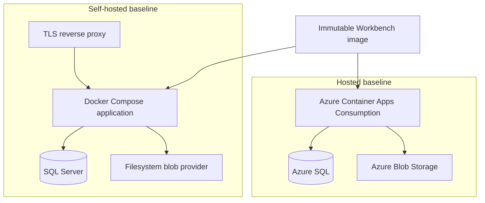

# Operations architecture

[Return to the main entry](ARCHITECTURE.md).

## Deployment profiles

| Profile | Application runtime | Structured data | Blob data | Public edge |
| --- | --- | --- | --- | --- |
| Local development | ASP.NET Core plus the client development server | Developer SQL Server instance | Filesystem provider | Localhost |
| Hosted baseline | Azure Container Apps Consumption, minimum zero replicas | Azure SQL | Azure Blob Storage | Managed HTTPS ingress |
| Self-hosted baseline | One application service in Docker Compose | SQL Server | Filesystem provider | TLS reverse proxy |

Hosted deployments use managed identity instead of stored Azure credentials wherever the selected
service supports it. Version-controlled Bicep describes Azure resources and configuration.

The self-hosted baseline targets one server but is configuration, not an application assumption.
Database, blob, email, session, and other durable providers are selected through configuration so the
same image can use external services or multiple replicas. Azure Container Apps may scale to zero;
the first request after idle may therefore have cold-start latency.

For self-hosting, the application origin listener is private to the deployment network by default.
Only explicitly configured proxy addresses or narrow networks may supply forwarded scheme or
client-address data, within a configured hop limit. Forwarded host is never consumed.
Production configuration requires an allowlisted public host and one canonical public origin. Security
links and redirects use that configured origin and never request-supplied host or forwarded metadata.
Startup validation rejects inconsistent proxy, origin, provider, and replica settings.

## Runtime and operations

### Statelessness and health

Replicas do not depend on sticky sessions, local durable files, or in-memory job state. Liveness
reports whether the process can run. Readiness verifies the dependencies needed to serve traffic and
must not report ready while required schema changes are absent. Graceful shutdown stops accepting new
work and allows bounded in-flight work to finish. Container-local files are read-only application
artifacts or disposable temporary data, never authoritative state.

### Configuration and secrets

The application uses validated, typed configuration. Environment variables and mounted secret files
are supported consistently across deployment profiles. Startup fails clearly when required settings
are absent or incompatible. Production profiles fail closed when required security, database,
storage, proxy, or key settings are missing, and development defaults cannot silently activate in
production. Secrets never enter the React build, source control, logs, or container image.

### Background work

SQL coordinates durable work and shared authentication limits so hosted and self-hosted installations
share one authority without additional queue and limiter services before a measured capacity need.
An external queue plus Redis would add operational dependencies; provider-native workflows would
duplicate semantics across installations. These remain future options when measurements justify
them, with explicit adapters and SQL authority preserved.

Initial background processing uses a durable SQL-backed queue with leases, retry policy, idempotency,
and dead-letter handling. Any replica may process work. Enqueueing and related business state changes
share a transaction or an outbox pattern so work is not silently lost. The scale-to-zero web process
is not a scheduler: scheduled work or work with bounded completion latency uses an explicit worker or
hosted job trigger reading the same durable state. Adding that deployable does not change application
job semantics or move domain authority out of SQL.

### Observability and audit

Operational telemetry uses fixed schemas. The central console logger exports timestamp, level,
fixed category, event number, trace ID and failure boolean; it does not export arbitrary structured
fields, formatted messages, exception text or scopes. The worker separately emits aggregate
`WorkQueueStatus` pending count and oldest due age through a narrow SQL procedure granted to workers.
Neither surface exports tenant rows. Operational telemetry must not expose
credentials, session values, connection strings, reset tokens, attachment contents, or unnecessary
personal or commercial data. Retention, sampling, and ingestion caps are explicit deployment settings.

Application boundaries emit only allowlisted structured fields. The central logger never evaluates
message formatters, providing the same closed export schema for framework, dependency, exception and
application logging. External infrastructure logs require separate access and retention controls.

Security-sensitive and financial actions produce append-oriented audit records that capture actor,
tenant, action, target, timestamp, correlation identifier, and safe outcome metadata. Ordinary users
and application flows cannot rewrite audit history. Audit records have explicit schemas,
authorization, and retention behavior and do not disappear because telemetry sampling changes.

### Backup and recovery

Every supported production profile documents backup and restore together. Hosted guidance covers
Azure SQL point-in-time recovery and configured blob recovery or versioning. Self-hosted tooling pairs
a SQL backup with a corresponding blob manifest or storage snapshot. Restore drills validate tenant
ownership, blob checksums, schema version, key availability, application startup, and representative
data access.

Backups are encrypted, stored outside the running application host, and identified by application and
schema version.

A restore invalidates every pre-restore browser session before the application becomes ready. The
procedure removes restored session records and rotates or advances authentication protection state so
a cookie issued against rolled-back account, role, or revocation data cannot become valid again.

Restore exercises succeed before a deployment profile is described as production-ready. Dependency
failures prevent readiness or return stable service errors; concurrency conflicts never silently
overwrite consequential state; partial blob failures remain recoverable; and tenant-isolation failures
fail closed while producing security-relevant telemetry that does not expose another tenant's data.

Exact recovery objectives remain a service-level decision, but a feature is not operationally complete
until both its SQL and blob state can be recovered coherently.

Strict paired recovery requires an exact manifest and verified retained bytes. The separate
[SQL-authoritative recovery workflow](operations/online-backup-recovery.md#manual-recovery) can accept
missing files through a reviewed report digest on an isolated restored database and distinct store.
It retains SQL records and records unavailable-file dispositions. Both routes keep the restore guard,
mandatory session/key sanitation and storage recovery gate; report acceptance never starts services
or authorizes production cutover.

### Release and migration

CI builds one non-root, minimal-runtime container image, generates an SBOM, scans dependencies and the
image, and records source revision, dependency inventory, and immutable image digest. Deployment
automation verifies that provenance before running the matching migration and releasing the image.

Migrations run separately using a principal with schema-change rights. Web replicas use a principal
without DDL or migration-history modification rights. Migration credentials are available only to the
controlled deployment operation and are never mounted into, stored by, or recoverable from the running
web workload. Migrations are forward-tested against Azure SQL and a supported self-hosted SQL Server
version using an empty database, the previous supported release schema, and representative tenant data
and constraints. Destructive changes use an expand, migrate, and contract sequence with a verified
backup and an explicit compatibility window. Application rollback is allowed only while the deployed
schema remains compatible; otherwise recovery follows the documented restore procedure.

The [principal matrix](operations/database-principals.md) defines principal custody; the
[migration runbook](operations/database-migrations.md) defines compatibility
checks, and rollback boundaries. The [backup/restore runbook](operations/database-backup-restore.md)
keeps cutover human-operated, writes an independent restore-pending marker before multi-user access,
and requires post-restore sanitation before readiness. Sanitation
deletes restored sessions, pending identity operations, and data-protection keys; advances every
user security version and stamp; records an audit event; advances the restore generation; and clears
the pending marker in the same transaction. Readiness verifies both signals.
